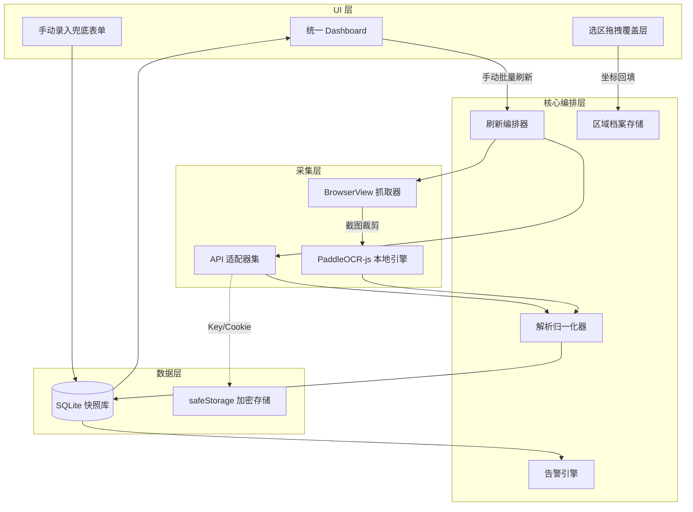

# 12 Architecture

> Template v2

## 分层图（可选 mermaid 围栏）

- UI 层只做交互与渲染；所有采集、解析、持久化均在主进程核心编排层完成，保证渲染进程崩溃不影响数据完整性。

- 采集层三条通道（官方 API / DOM / OCR）对编排器暴露统一接口，归一化器屏蔽厂商差异。

## 模块职责

| 模块 | 输入 | 处理 | 输出 | |---|---|---|---| | 统一 Dashboard | 快照查询条件、筛选参数 | 聚合渲染额度卡片、历史趋势图、告警状态 | 额度视图、采集失败红字原因码、刷新入口 | | 选区拖拽覆盖层 | BrowserView 页面上的鼠标拖拽轨迹 | 叠加透明选区 UI 捕获框选，换算为 devicePixelRatio 感知的相对坐标，即时试运行 OCR 出预览 | 区域档案 {x, y, w, h, 上下文}（一次配置、持久化、终身复用） | | 刷新编排器 | 用户「批量刷新」指令 | 按 Vendor 配置分发适配器/抓取任务，控制并发、超时与重试 | 标准化快照或失败原因码 | | API 适配器集 | safeStorage 解密后的 Key/Endpoint | 调用各厂商余额/用量接口，字段映射到统一模型 | 结构化额度 JSON | | BrowserView 抓取器 | 会话 Cookie + DOM 选择器或区域档案 | 加载控制台页面，querySelector 提取文本；无 DOM 可选时按区域档案截图裁剪 | 原始文本或图像块 | | PaddleOCR-js 引擎 | 裁剪后的图像块 | 本地离线推理，识别数字、单位、小数点 | 识别文本 | | 解析归一化器 | 原始 JSON / OCR 文本 | 正则抽取、单位换算（$/token/credit）、识别置信度与失败判定 | {已用, 剩余, 单位, 来源, 时间戳} | | 告警引擎 | 新快照 + 用户阈值配置 | 剩余额度阈值比较与环比趋势判断 | 系统通知、角标、告警记录 | | 手动录入兜底 | 用户人工输入的数字 | ≤3 次点击完成（点卡片 → 填数字 → 确认），标记 source=manual | 人工快照入库 |

## 数据流

- **刷新主链路**：点击「批量刷新」→ 刷新编排器按 Vendor 并行分发 → API 适配器直连余额接口，或 BrowserView 加载页面后走 DOM 提取；无选择器时按持久化区域档案截图裁剪 → PaddleOCR-js 本地识别 → 归一化写入 SQLite 快照表 → Dashboard 增量渲染，全程用户只按一次按钮。

- **区域配置链路**：首次配置某 Provider 时在 BrowserView 上叠透明选区层，用户像截图工具一样所见即所得拖框 → 系统立即对该区域试运行一次 OCR 并弹出预览确认 → 坐标自动回填并持久化为区域档案，此后每次刷新自动复用，彻底零手填 x/y/w/h。

- **失败兜底链路**：任一环节失败 → 对应卡片置红并显示原因码（网络/DOM 失效/OCR 低置信）→ 用户点击「手动录入」，≤3 次点击写入人工快照并标记来源，趋势图中以独立图例区分机器与人工数据。

- **告警链路**：快照落库后告警引擎即时比对阈值（如剩余 <20%）→ 触发系统通知与 Dashboard 角标，告警历史随快照一并持久化。

## 关键依赖

- **Electron**：多窗口与 BrowserView 承载厂商控制台页（新版 Electron 弃用 BrowserView，需封装隔离层以便迁移 WebContentsView）；safeStorage 加密 API Key 与 Cookie，明文永不落盘。

- **PaddleOCR-js**：本地 onnxruntime 推理，PP-OCR 轻量裁剪模型随安装包离线分发，识别过程零外部请求。

- **better-sqlite3**：本地快照/区域档案/告警记录单文件存储，随应用数据目录保存。

- **厂商开放接口**：各适配器直连官方余额/用量端点，仅 HTTPS 出站，无自建服务端。

- **轻量图表库（ECharts 按需引入）**：历史趋势渲染，数据量按快照 retention 策略裁剪。

## 部署

- 单机安装包分发（Windows NSIS / macOS DMG），无服务端、无账号体系；全部数据留在本地 userData 目录，卸载可选择性清除。

- OCR 模型与 better-sqlite3 等原生模块按平台预编译打入安装包，安装后完全离线可用（仅采集动作需要联网）。

- 适配器字段映射与 DOM 选择器规则做成独立规则包（JSON/JS），厂商改版时可只热更规则包，不必整包升级应用。

## 风险

- **厂商控制台 DOM/布局频繁改版**导致选择器与区域档案失效：以 OCR 区域档案为主路径天然抗 DOM 变更；极端情况下用户重新拖框 10 秒内完成修复，配合规则包热更兜底。

- **DPI 缩放 / 窗口尺寸变化 / 暗色主题**造成截图坐标漂移或识别率下降：区域档案存储相对坐标并记录 devicePixelRatio，抓取时按当前状态换算；配置时强制试运行预览，识别置信度低于阈值即拒绝保存并提示重新框选。

- **BrowserView 弃用与 Electron 升级破坏性变更**：抓取器对上层只暴露统一接口，底层 BrowserView/WebContentsView 可替换，避免采集逻辑与 Electron API 强耦合。

- **本地 Key/Cookie 安全**：仅经 safeStorage 加密存储于磁盘，进程间传递走 IPC 白名单，任何遥测路径均不含凭据与额度明细。

- **PaddleOCR 模型体积与常驻内存开销**：采用轻量裁剪模型并懒加载，仅在存在 OCR 型 Provider 配置或执行刷新时拉起推理，空闲期释放。